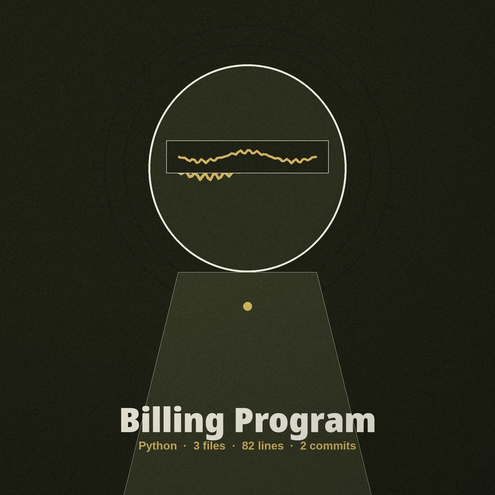
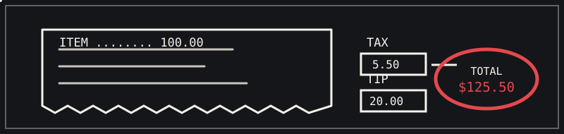

<p align="center"></p>

<h1 align="center">Billing-Program</h1>

<p align="center"><strong>A simple Python program that calculates a bill with tax and tip.</strong></p>

<p align="center">  </p>

<p align="center"></p>

**The Chalk Receipt**
_A long receipt unrolls in white chalk on a black board, and tax and tip tally into one circled total marked once in red._

A single-file interactive Python program that builds a simple receipt for
one item: it applies tax, adds a tip, and prints the overall cost.


## Quick Start

```bash
git clone https://github.com/Epsilon0xCell/Billing-Program.git
cd Billing-Program
python3 billing.py
```

Sample session, with cost `100` and tip percent `20`:

```text
Tax Paid: 5.50
Tip amount: 20.00
Your overall cost is: $125.50
```


## Contents

- [Quick Start](#quick-start)
- [Requirements](#requirements)
- [Running it](#running-it)
- [How the total is calculated](#how-the-total-is-calculated)
- [Worked example (verified)](#worked-example-verified)
- [Input errors](#input-errors)
- [Files](#files)
- [Contributing & License](#contributing--license)


## Requirements

- Python 3, standard library only.


## Running it

```bash
python3 billing.py
```

The program prompts, in order:

1. `What is the cost of the item?`
2. `What is the tip percent?` (a percent, so `20` means 20 percent)


## How the total is calculated

| Feature | What It Does | Example |
| --- | --- | --- |
| Tax Calculation | Fixed 5.5 percent of the item cost | $100 gives $5.50 |
| Tip Calculation | Tip percent of the item cost | 20% of $100 gives $20.00 |
| Total | Cost + tax + tip | $100 + $5.50 + $20.00 = $125.50 |
| Input Validation | Rejects non-numeric, non-finite, and negative input with a plain message and exit 1 | Non-numeric input prints `Please enter a number.` |

- Tax is 5.5 percent of the item cost: `tax_paid(cost)` returns
  `cost * 0.055`.
- The tip is the tip percent of the item cost: `total_percent_paid(cost,
  tip_percent)` returns `cost * tip_percent / 100`.
- The overall cost is `cost + tax + tip`.
- Tax, tip, and overall cost are printed to two decimal places, and the
  overall cost is prefixed with `$` by `overalltotalcost`.

<p align="center"><em>Example: How a $100 bill is calculated</em></p>

<p align="center"></p>


## Worked example (verified)

Input cost `100` and tip percent `20` prints:

```text
Tax Paid: 5.50
Tip amount: 20.00
Your overall cost is: $125.50
```

Input cost `19.99` and tip percent `15` prints tax `1.10`, tip `3.00`,
and an overall cost of `$24.09`.


## Input errors

- Non-numeric input, the non-finite values `inf` and `nan`, or closed
  input (EOF), prints `Please enter a number.` and exits with status
  1, with no traceback.
- A negative cost or tip percent prints `Please enter a number that is
  not negative.` and exits with status 1.
- Zero is accepted for both prompts.

Tests: `python3 -m unittest` covers the money functions and scripted
runs, including the rejected `inf` and `nan` cases.


## Files

- `billing.py` - the program.
- `assets/banner.png`, `assets/logo.png` - project branding.
- `LICENSE` - GPL-3.0.


## Contributing & License

Contributions are welcome. Please open an issue first for major changes.

GPL-3.0; see LICENSE.
